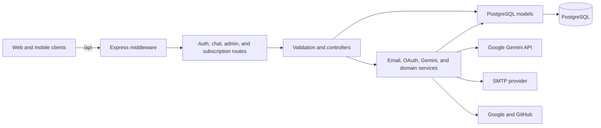
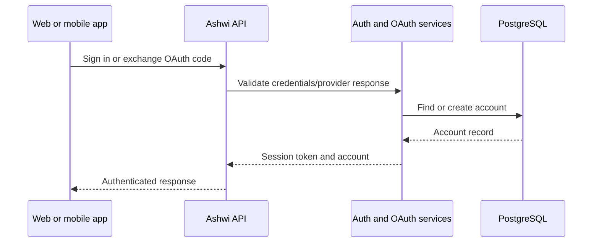

# Ashwi backend

The Ashwi API is an Express service backed by PostgreSQL. It handles account authentication, email verification, Google/GitHub OAuth, profession-aware AI chat, conversation history, subscriptions, and administrative operations.

## Architecture





## Run locally

Requirements: Node.js, pnpm, and a running PostgreSQL instance.

```powershell
pnpm install
Copy-Item .env.example .env
# Set DATABASE_URL and AI, mail, and OAuth credentials in .env.
pnpm dev
```

The default local API origin is `http://localhost:5000`; routes are mounted under `/api`. On startup, the service checks the database connection and initializes the schema. Never commit `.env`; use `.env.example` as the safe configuration template.

## Environment configuration

- `DATABASE_URL` configures PostgreSQL. Individual `DB_*` settings are also supported.
- `JWT_SECRET` must be replaced with a long random secret. `JWT_EXPIRATION` sets the token lifetime.
- `GEMINI_API_KEY` configures AI chat; `GEMINI_MODEL` selects the Gemini model.
- `SMTP_*` settings configure verification and password-reset email.
- `CLIENT_URL`, `CORS_ORIGIN`, and `FRONTEND_PUBLIC_URL` identify the local or deployed frontend.
- Google and GitHub OAuth require provider client IDs/secrets and registered callback URLs from `.env.example`.

Keep credentials in local or deployment environment variables. Do not put secrets in source, logs, example files, or screenshots.

## Routes and checks

Main endpoint groups are `/api/auth`, `/api/chat`, `/api/admin`, and `/api/subscriptions`. Health and diagnostic endpoints are exposed by the Express app for local operations.

```powershell
pnpm build
pnpm db:check
pnpm test:database
pnpm test:oauth
```
